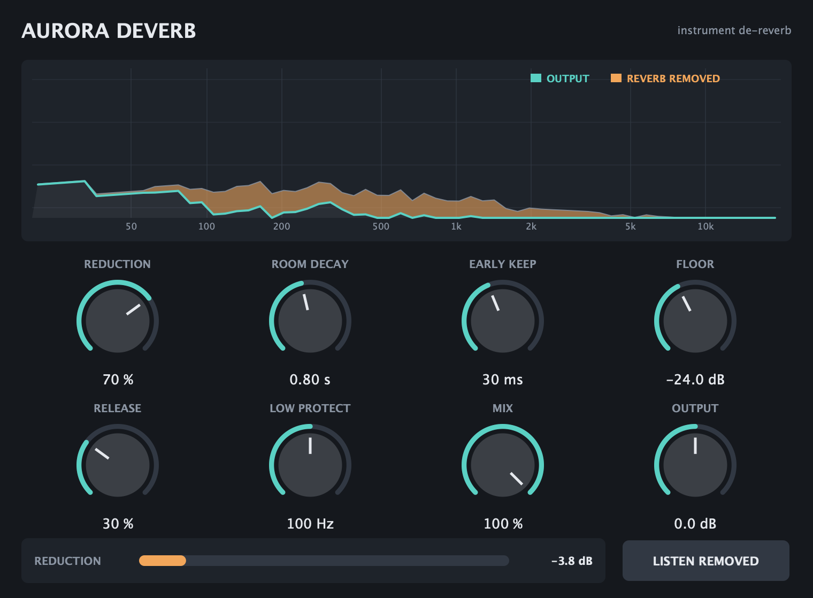

# Aurora DeVerb



Plugin de **de-reverb para instrumentos**: reduz a reverberação, o eco e o som de sala de gravações de violão, guitarra, piano, bateria, cordas etc., sem amassar os ataques das notas.

- Formatos: **AU, VST3, Standalone** (VST2 opcional, veja abaixo)
- **Universal**: nativo em Apple Silicon e Intel
- Latência: 2048 amostras a 44,1/48 kHz (4096 a 88,2/96 kHz), informada ao DAW para compensação automática

## Como funciona

Processamento espectral (STFT, janelas de ~43 ms com 75% de sobreposição) baseado no modelo estatístico de decaimento de sala publicado por Lebart et al. (2001) e Habets (2007). A reverberação tardia em cada frequência é prevista a partir do que tocou *Early Keep* ms atrás, decaída pelo RT60 da sala (*Room Decay*), e removida por subtração espectral. Detalhes que importam para instrumentos:

- **Ataques preservados:** quando chega uma nota nova (muito mais energia do que a sala explicaria), o ganho abre na hora.
- **Graves protegidos:** abaixo de *Low Protect*, o processamento diminui gradualmente.
- **Imagem estéreo intacta:** L e R recebem o mesmo ganho.
- **Sem "artefato de aquário":** suavização em tempo e frequência e um piso (*Floor*) de atenuação máxima.

## Controles

| Controle | Faixa | O que faz |
|---|---|---|
| **Reduction** | 0–100% | Quanto da reverb estimada é removido |
| **Room Decay** | 0,1–5 s | RT60 da sala da gravação: ajuste até a cauda sumir sem afinar o instrumento |
| **Early Keep** | 10–150 ms | Quanto do som logo após a nota é considerado "direto". Menor = mais seco |
| **Floor** | −40–0 dB | Atenuação máxima por frequência |
| **Release** | 0–100% | Velocidade com que a redução atua na cauda (maior = mais suave) |
| **Low Protect** | 20–500 Hz | Abaixo disso o processamento é aliviado |
| **Mix** | 0–100% | Seco/processado (alinhado em fase, sem comb filter) |
| **Output** | ±12 dB | Ganho de saída |
| **Listen Removed** | on/off | Ouve só o que está sendo removido, ótimo para ajustar |

**Analisador:** a linha verde é o som de saída; a área laranja é a reverb sendo removida em cada frequência, em tempo real.

**Ponto de partida:** Reduction 70%, Room Decay 0,8 s, Early Keep 30 ms. Ligue *Listen Removed* e suba *Room Decay*/*Reduction* até ouvir só a sala, sem a nota. Depois desligue.

## Download

Os instaladores prontos (`.dmg`, `.pkg`, `.zip`) ficam em **Releases**. Cada push na `main` também gera os arquivos em **Actions → artifacts**.

## Compilar localmente (macOS)

Requisitos: Xcode e CMake ≥ 3.22. O JUCE 8.0.9 é baixado automaticamente.

```bash
cmake -B build -G Xcode -DAURORA_COPY_AFTER_BUILD=ON
```

```bash
cmake --build build --config Release --target AuroraDeVerb_All
```

Instalador:

```bash
packaging/make_installer.sh build/AuroraDeVerb_artefacts/Release 1.0.0 dist
```

Para assinar com Developer ID, defina `APP_SIGN_ID` e `INSTALLER_SIGN_ID` antes de rodar o script.

### VST2 (opcional)
O SDK VST2 não é mais distribuído pela Steinberg. Se você tem uma cópia licenciada:

```bash
cmake -B build -G Xcode -DAURORA_VST2_SDK_PATH=/caminho/para/VST2_SDK
```

### Testes do DSP (qualquer sistema)

```bash
c++ -O2 -std=c++17 -ISource tests/test_engine.cpp -o engine_tests && ./engine_tests
```

## Licença do JUCE
O projeto usa o framework [JUCE](https://juce.com). Para distribuir o plugin, confira os termos da licença JUCE 8 (gratuita até um limite de faturamento, ou AGPLv3).
